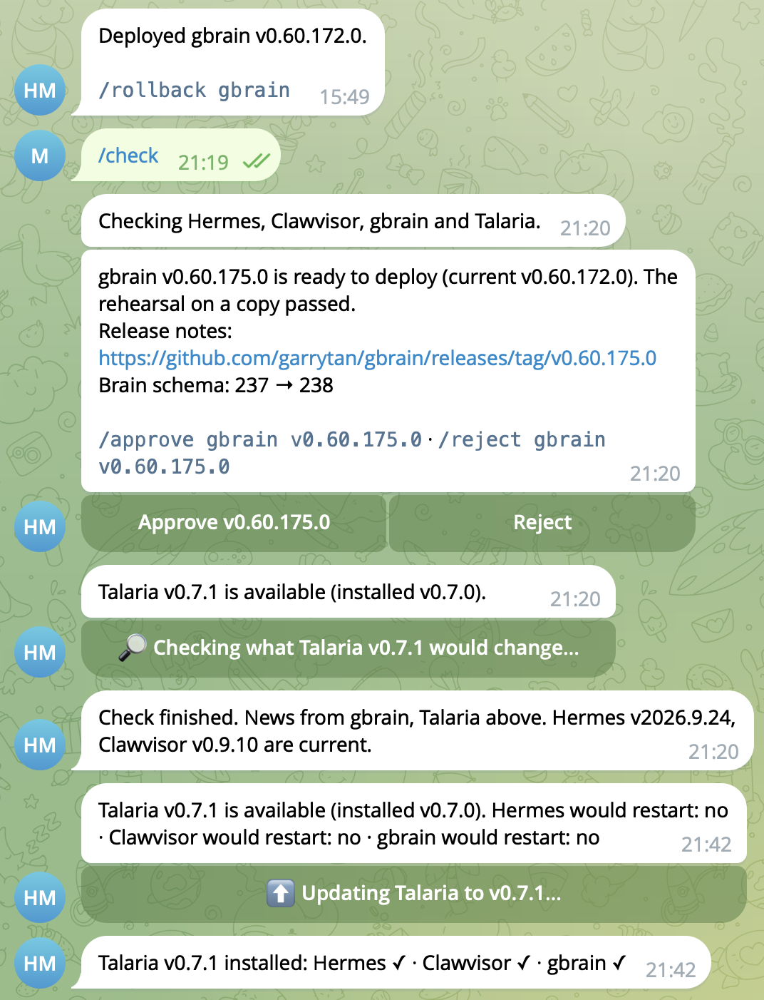

# Talaria

[](https://github.com/maxpfingsthorn/talaria/releases)
[](https://github.com/maxpfingsthorn/talaria/actions/workflows/ci.yml)
[](LICENSE)


**Updates for self-hosted AI agent apps that ask first and can undo themselves.**
Today it manages [Hermes Agent](https://github.com/NousResearch/hermes-agent),
[Clawvisor](https://github.com/clawvisor/clawvisor) and [gbrain](https://github.com/garrytan/gbrain).

Before you are asked, Talaria runs each new release's migrations and checks against a copy
of your data. It then asks you in Telegram, deploys with a backup, and rolls back image and
data together if the deploy fails its health check.

<p align="center">
  
</p>

1. **Find** a new release and check the download against what the release publishes.
2. **Rehearse** it on a throwaway copy of your data, offline: the new release migrates the
   copy and runs its own checks there (the table below says which), and you get a report of
   what would change.
3. **Ask** you in Telegram: Approve or Reject.
4. **Back up, deploy, check health.** On failure, image and data roll back together.

Nothing runs as root after setup: each app lives in its own service account under
rootless podman. Talaria is young (since September 2026) and runs daily on the author's own
host. Early users are welcome; broader installation and recovery experience is still
limited. Linux, systemd and rootless podman only.

| App | What it is | What the rehearsal runs | Guide |
|---|---|---|---|
| [Hermes Agent](https://github.com/NousResearch/hermes-agent) | the agent itself | config and database migrations, `hermes doctor` and a config diff; the gateway is not started | [docs/apps/hermes.md](docs/apps/hermes.md) |
| [Clawvisor](https://github.com/clawvisor/clawvisor) | a gatekeeper service for AI agents | starts the new release on the copy and waits until it is ready; reports the migrations it applied | [docs/apps/clawvisor.md](docs/apps/clawvisor.md) |
| [gbrain](https://github.com/garrytan/gbrain) | an agent memory "brain" with an MCP server | `gbrain doctor` (applies the schema migration) and a recall of a marker page; the server is not started | [docs/apps/gbrain.md](docs/apps/gbrain.md) |

All three run under one Telegram bot. Setting this up with a coding agent? Point it at
[`AGENT_SETUP.md`](AGENT_SETUP.md).

**gbrain rehearsal briefly stops the running server to copy its PGLite data, before
approval.** It restarts the current version before testing the copy. Copy time, and thus
downtime, grows with the size of the brain.

## What it does

- **Finds new releases** of each app and fetches them with an integrity check: Hermes's
  container image pinned by digest and checked against the release's git commit; Clawvisor's
  and gbrain's release binaries checked against the checksums their release publishes (gbrain
  also against its build provenance when `gh` is available), then built into a local image.
  These checks compare the download with what the same release publishes (integrity, not an
  independent signature).
- **Rehearses the update on a throwaway copy** of your data, offline, and reports what would
  change:
  Hermes's config and database versions, migrations and a config diff; Clawvisor's database
  migrations; gbrain's schema version.
- **Waits for your approval** on Telegram: one bot per host for every app.
- **Backs up, deploys and checks the result.** On failure it rolls back image and data
  together; you can trigger the same rollback, or restore any backup, at any time.
- **Runs maintenance windows** where an app needs them (gbrain's nightly `gbrain dream`).
- **Sends dashboard login links** on request (`/login`, for Clawvisor and gbrain).
- **Updates itself** the same way: a new Talaria release is offered, never installed unasked.
- Messages you only for decisions and failures.

Opinionated: one install of each app per host, one dedicated service user per app plus one
hub account per host, rootless podman with Quadlet, Telegram for approvals.

Scope: Hermes installs that run from the official container image (not the git-based
`hermes update` path); Clawvisor and gbrain from their GitHub release binaries.

Not supported, and not planned for now: Docker (rootful or rootless), Kubernetes, macOS,
messengers other than Telegram, and Hermes installs updated with `hermes update`.

No telemetry: Talaria itself talks only to GitHub (release tags and assets), the container
registries it pulls images from and the Telegram Bot API. It reports nothing about your
installation to anyone.

Talaria is an independent project and is not affiliated with or endorsed by Nous Research,
the Clawvisor project or the gbrain project.

## How it fits together


Each app runs in its own account with its own rootless podman, data and backups. The hub
account holds the only bot token and no app data; it can run nothing but `talaria op` as
each app. Podman networks cannot cross accounts, so containers reach each other only
through a published host address (see [Clawvisor](docs/apps/clawvisor.md)).

## Requirements

- Linux with systemd user units and linger (tested on Ubuntu 24.04).
- Rootless podman ≥ 4.9 with Quadlet.
- `git`, `python3` ≥ 3.10, GNU `tar`, `gzip`, `sudo`.
- amd64 or arm64 (gbrain: amd64 only; it publishes no arm64 Linux build).
- Hermes ≥ v2026.6.5 (existing installs older than that are refused).
- SELinux in enforcing mode is not supported.

## Setup by hand

```bash
git clone https://github.com/maxpfingsthorn/talaria && cd talaria
git checkout "$(bin/talaria latest-release)"
bin/talaria setup --plan --user hermes   # what would happen
bin/talaria setup --user hermes          # run again until it prints DONE
```

`--user` names the app's service account; setup creates it if it does not exist. Setup
also creates the hub account `talaria` (once per host; `--hub NAME` picks another name),
which runs the one Telegram bot and the daily check for every app on the host. Both happen
through one command you paste into your own terminal (sudo asks for your password). Clone
over https as shown: setup installs Talaria for both accounts from your checkout's origin,
and they have no SSH key.

`latest-release` reads the published stable GitHub Release, so a tag whose checks are
still running is not selected. If the lookup fails, stop and retry; do not select a tag
by sorting the tag list. For a disposable evaluation, see [Trying Talaria](docs/trying.md).

`--app hermes|clawvisor|gbrain` picks which app to manage (default `hermes`; the account
defaults to the app's own name, e.g. `clawvisor`, unless `--user` says otherwise). Once
`talaria.conf` exists, its `app` wins: re-running setup with a different `--app` stops
with an error instead of silently switching apps.

Setup never guesses. Each run does what it can and stops at the next thing only you
can do:

```
MISSING: podman >= 4.9 (found 4.3.1)
  hint: Debian/Ubuntu: apt install podman · Fedora/RHEL: dnf install podman · Arch: pacman -S podman
ACTION REQUIRED: paste this into your terminal (sudo asks for your password), then run setup again with --user hermes: …
ACTION REQUIRED: in a private chat with your bot, send within 15 minutes:
  /pair K7M2QX9P
FOUND: Hermes unit hermes-gateway.service (container hermes-gateway)
STOP: several Hermes installs; choose one with --adopt UNIT
NOTE: check.time in talaria.conf is not used any more; set it in the hub's hub.conf
DONE
```

Exit codes: 0 done · 10 a person must act · 1 stop or error.

The bot token is never typed into a chat or an agent. You store it yourself, once per
host, as the hub: `sudo -u talaria -H ~talaria/.local/bin/talaria set-token` (setup prints
the exact command). A second app on the same host uses the same bot: no new token, no
pairing.

## Daily use

| Telegram command | Effect |
|---|---|
| `/status` | every app: version and state, free disk, data size, dashboard address (Hermes), pending update, interrupted change |
| `/check` | look for new releases now, for every app and for Talaria itself; always ends with a summary, even when nothing is new |
| `/check <app>` | the same for one app |
| `/check talaria` | only the Talaria release: the release notice if there is a newer one, else "Talaria vX is current." |
| `/approve [app] <tag>` | deploy the pending update |
| `/reject [app] <tag>` | never offer this release again |
| `/rollback [app]` | describe what a rollback would restore, and how old the backup is |
| `/rollback [app] CONFIRM` | roll back |
| `/backups [app]` | list backups |
| `/restore [app] <id>` / `/restore [app] <id> CONFIRM` | describe / restore a backup |
| `/restart [app]` | stop and start the app's container (same image, same data); refused while an interrupted change waits for `/rollback CONFIRM` |
| `/login [app] [OAuth request id or consent URL]` | a one-time admin login link for gbrain or Clawvisor, sent with previews off and replaced by an "expired" notice after 5 minutes; `/status` has a button for it |
| `/update <version>` | show which apps a Talaria update would restart, with an **Update** button (what the daily notice's **What would vX change?** button does) |

With one app registered, the app name is optional. With several, a command without one
answers "Which app?" with a button per app (not `/check`, which checks everything, and not
`/restart`, which asks you to type the app name); the button runs the read-only or describe
form (status, rollback description), never a confirm.

The bot registers these commands with Telegram, so they appear under the **Menu**
button in your chat (and nowhere else). The daily Talaria release notice only says a release is available, with a **What would vX change?** button; nothing runs on any app until you tap it (or send `/update vX`), and then the restart check and the **Update** button follow. App update offers come with **Approve** and
**Reject** buttons; `/rollback` and `/restore <id>` answer with a confirm button, so
you never have to type `CONFIRM`. Each button names what it acts on and is checked
against the current state: an old button is refused instead of acting on something
else. Rollback and restore buttons expire after an hour. After a tap, the buttons are replaced by one status button (for example "✅ Approved — deploying vX"); the report above stays.

You get a message when an update is ready, after a deploy, rollback or restore, when
something fails, after an interrupted change, and once per new Talaria release (a notice with a **What would vX change?** button; the restart list and the **Update** button follow when you tap it).
Nothing else.

**A rollback replaces the data with the backup taken before the last deploy.** `/rollback`
shows that backup's age before you confirm. Talaria first backs up the current data, and
the rollback message names the `/restore <id> CONFIRM` that undoes it.

## Manual recovery

If a rollback itself fails, Hermes stays stopped and the file
`~/.local/state/talaria/changing` exists (it keeps systemd from starting Hermes on
half-changed data). As the service user (`sudo -u <user>` from another account):

1. `talaria backups` and pick a backup.
2. `talaria restore <id> --confirm`.
3. If that fails too:
   ```bash
   sudo -u <user> XDG_RUNTIME_DIR=/run/user/$(id -u <user>) systemctl --user stop hermes.service
   mv <data_dir> <data_dir>.broken && mkdir <data_dir>
   tar -xzf ~<user>/.local/state/talaria/backups/<id>.tar.gz -C <data_dir>
   rm ~<user>/.local/state/talaria/changing
   sudo -u <user> XDG_RUNTIME_DIR=/run/user/$(id -u <user>) systemctl --user start hermes.service
   ```
4. Send `/rollback` in the bot and read its answer. If it offers to start and check the app
   ("left nothing to undo"), confirm with `/rollback CONFIRM`: it starts the app and clears
   the interrupted state. If it offers to restore a backup instead, do not confirm (that
   would replace the data you just put back); use `/restore` or the shell steps above.
   Until the interrupted state is cleared, Talaria refuses new changes and `talaria backup`.

## Documentation

- Per app: [Hermes](docs/apps/hermes.md), [Clawvisor](docs/apps/clawvisor.md),
  [gbrain](docs/apps/gbrain.md)
- [Configuration](docs/configuration.md): every `talaria.conf` and `hub.conf` key
- [Security](docs/security.md): trust model, what setup changes, removing the sudo rules
- [Operations](docs/operations.md): updating Talaria, uninstalling
- [Design](docs/design.md): how the pieces fit, the update flow and its failure handling
- [Changelog](CHANGELOG.md)

## How it's built

Talaria is written with AI coding assistants (Claude Code). The maintainer designs, reviews
and decides changes. The checks exercise migrations, account isolation and recovery:

- unit tests on Python 3.10 and 3.13 on every pull request;
- end-to-end tests in CI that create real service accounts and drive rootless podman,
  systemd user units, sudo rules and a fake Telegram and release server through updates,
  rollbacks, restores and self-updates;
- weekly contract tests against the newest upstream releases of all three apps;
- mutation testing: releases require at least 85 % (see the dated
  [historical report](docs/mutation-report.md), and current results in Actions);
- larger changes get an independent review pass before they are merged.

These checks do not establish that every failure is recoverable. Regression tests cover
known failures; integration tests use stand-in apps, and real-world experience is limited.

## Development

```bash
uv sync
uv run pytest                                          # unit tests
TALARIA_E2E=1 uv run pytest -m e2e tests/e2e          # disposable machine only (creates users)
TALARIA_CONTRACT=1 uv run pytest -m contract tests/contract   # pulls the newest Hermes image
uv run mutmut run && uv run mutmut export-cicd-stats && uv run python tests/mutation_score.py
```

CI runs the unit tests on every push and pull request. The end-to-end tests run on pull
requests into `main`, on `main` itself, on release tags and on demand (Actions → ci → Run
workflow). The contract test and mutation testing run weekly and on release; see
[`docs/mutation-report.md`](docs/mutation-report.md).

How to contribute, and the rules that keep existing installs working, are in
[`CONTRIBUTING.md`](CONTRIBUTING.md).

Releases: a pull request from `develop` to `main`, which also needs `e2e`, then a `vX.Y.Z`
tag on `main`, which runs CI, mutation testing and the contract test and publishes the
GitHub release. Release tags cannot be moved or deleted.

Releases come at most once a week unless a fix is urgent. Each one has an entry in
[`CHANGELOG.md`](CHANGELOG.md) written for the people running Talaria: what changes for
them, anything they have to do, and how to update. After the release workflow publishes, the
GitHub release notes are replaced with that entry.

Licence: MIT.
