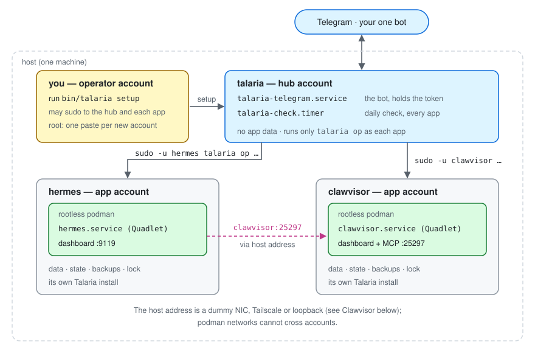

# Design

How Talaria is put together, how an update moves through it, and what happens when a step
fails. The trust model is in [security.md](security.md).

## Accounts

- **Each app** runs in its own service account with its own rootless podman, data, state and
  backups. Talaria is installed per account from a release tag.
- **The hub account** (default `talaria`) runs the only Telegram bot and the daily timers. It
  holds the bot token and no app data, and may run only `talaria op …` as each app (one sudo
  rule per app).
- **Your login account** runs setup. Setup prints the few commands that need root for you to
  paste; Talaria itself never runs as root.

## Code

Talaria is a small app-neutral core (state, backup, deploy, rollback, restore,
rehearsal, setup, notify) plus a thin per-app adapter under `talaria/apps/` that
supplies everything that differs between the apps Talaria can manage: release
discovery and image fetch, health and data-version checks, quadlet template
variables, secret setup and the texts shown to you. `ctx.app` is the adapter in
use; `talaria.apps.get(name)` looks one up by the `app` key in `talaria.conf`.
`talaria/apps/hermes.py`, `talaria/apps/clawvisor.py` and `talaria/apps/gbrain.py` are the adapters today. `talaria/maintain.py` (app side) and `talaria/hubmaintain.py` (hub timer) run maintenance windows.

One hub account per host runs the Telegram bot and the daily timer (`talaria/telegram.py`,
`talaria/hubcheck.py`, `talaria/hubupdate.py`); `hub.conf` makes an account the hub
(`talaria/hubconf.py`). The hub reaches each app only through `talaria op`
(`talaria/op.py`), run as the app's account through one sudo rule (`talaria/hubexec.py`).
`op` writes JSON lines, which `talaria/relay.py` turns into Telegram messages, prefixing
button data with the app's name.

## An update, step by step

1. **Check.** The hub's daily timer asks each app (`op check`) for new releases. The app
   lists upstream release tags and, for Hermes, the matching registry tags.
2. **Fetch and verify.** The app fetches the release: Hermes's image pinned by digest and
   checked against the release commit; Clawvisor's and gbrain's binaries checked against the
   published checksums (gbrain also against its build attestation when `gh` can check it),
   then built into a local image.
3. **Rehearse.** The data dir is copied (fd-based walk that never follows symlinks; SQLite
   files through the backup API) and the new release runs against the copy with networking
   off. What runs depends on the app (see the table in the [README](../README.md)). A
   failure here ends the attempt; production is untouched.
4. **Offer.** The result becomes the *pending* candidate and the bot sends the report with
   Approve and Reject buttons. Nothing changes until you approve.
5. **Deploy** (on Approve):
   1. Check free disk space and that the image is present; otherwise refuse, nothing stopped.
   2. Record the operation in the state file, stop the app, commit the config history and
      take a full backup. If any of this fails, start the app again; nothing changed.
   3. Write the **marker** file (`~/.local/state/talaria/changing`) naming the backup and
      the previous image. While it exists, the app's unit refuses to start
      (`ExecCondition`), so a crash from here on cannot start a half-changed app.
   4. Run the app's `before_start` step (gbrain: migrate the stopped production brain and
      compare its schema with the rehearsal's).
   5. Switch the `current` image tag, clear the marker, start the app and run the health
      checks (unit active, then the app's own check, e.g. an HTTP health endpoint).
6. **Fail safe.** If step 5.4 or 5.5 fails, the marker is written again and the rollback
   restores the backup *and* the previous image, then starts the app. If that fails too,
   the app stays stopped and you are told how to recover by hand.

## Interrupted operations

If the process dies mid-deploy, rollback or restore, the marker stays and the app cannot
start. The bot reports it at its next start and `/rollback` (or `/rollback CONFIRM`) finishes
the job from the recorded backup. The [README](../README.md#manual-recovery) describes the
manual path.

## Updating Talaria itself

The hub fetches the new tag, re-runs its own setup, then updates each app (`op
self-update`), passing the commit it installed so every app installs the same code, and
restarts the bot last. The update *to* a version is carried out by the version before it.
See [operations.md](operations.md) and, for the compatibility rules this implies,
[CONTRIBUTING.md](../CONTRIBUTING.md#rules-that-keep-existing-installs-working).
